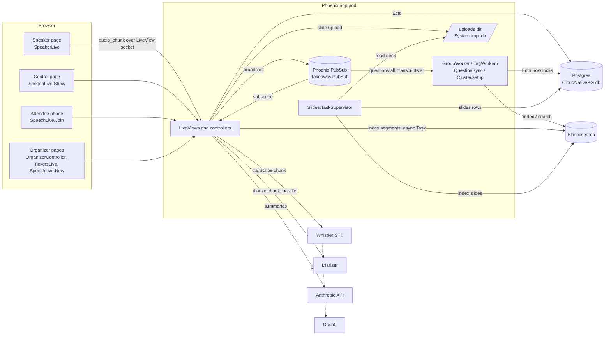

# Architecture

Takeaway is one Phoenix LiveView application (`app/`) backed by Postgres, with optional sidecar services for search, speech-to-text, speaker diarization, summaries and tracing. Every optional service sits behind a behaviour or a config switch, and the app runs with any of them missing (see [configuration.md](configuration.md)).

This page covers the parts and how they talk to each other. The feature flows are in [pipeline.md](pipeline.md) (audio to transcript to summary) and [questions.md](questions.md) (submission, tagging, grouping). Tables and context APIs are in [domain-model.md](domain-model.md).

## Components

| Component | What it does | Where it is wired | Required? |
|---|---|---|---|
| Phoenix app (`app`) | HTTP, LiveViews, all domain logic, background workers. Deployed as Deployment `app`, 2 replicas (`deploy/deployment.yaml`); 1 replica in `deploy-self/app.yaml`. | `app/lib/takeaway/application.ex`, `app/lib/takeaway_web/endpoint.ex` | Yes |
| Postgres (CloudNativePG Cluster `db`) | Source of truth for every table. Migrations run in the `migrate` init container (`/app/bin/migrate`, `Takeaway.Release.migrate/0`). | `deploy/db.yaml`, `DATABASE_URL` from Secret `db-app` | Yes |
| Elasticsearch 8.17 (StatefulSet `elasticsearch`) | Derived search index: `questions`, `transcript_segments`, `slides`, `notes`. Used for question grouping candidates and context matching. Postgres stays authoritative; search failures degrade to "no match". | `deploy/elasticsearch.yaml`, `app/lib/takeaway/elasticsearch.ex`, `ELASTICSEARCH_URL` | No |
| Whisper STT (Deployment `whisper`, `speaches` image) | OpenAI-compatible `/v1/audio/transcriptions`. Called once per audio chunk. | `deploy/whisper.yaml`, `app/lib/takeaway/stt/whisper.ex`, `STT_URL` | No (`Takeaway.STT.Disabled` drops audio) |
| Diarizer (Deployment `diarizer`, `diarizer/server.py`) | `POST /v1/diarize`: speaker turns per chunk, voiceprints kept per speech. | `deploy/diarizer.yaml`, `app/lib/takeaway/diarizer.ex`, `DIARIZER_URL` | No (`Takeaway.Diarizer.Disabled`) |
| Anthropic Messages API | Prose for post-speech summaries. | `app/lib/takeaway/llm/anthropic.ex`, `ANTHROPIC_API_KEY` (`app/config/runtime.exs`) | No (`Takeaway.LLM.Disabled`, extractive fallback). `deploy/deployment.yaml` does not set the key. |
| Dash0 | OTLP/HTTP trace export: Bandit, Phoenix, LiveView, Ecto spans plus custom spans such as `slides.extract`. | `app/config/config.exs`, `app/config/runtime.exs` (`DASH0_AUTH_TOKEN`), `app/lib/takeaway/otel_sampler.ex` | No (exporter `:none`) |

Details per service: [pipeline.md](pipeline.md) (Whisper, diarizer, Anthropic), [questions.md](questions.md) (Elasticsearch), [observability.md](observability.md) (Dash0), [deployment.md](deployment.md) (manifests and budget).

## Supervision tree

`Takeaway.Application.start/2` (`app/lib/takeaway/application.ex`) first calls `OpentelemetryBandit.setup/0`, `OpentelemetryPhoenix.setup/1` and `OpentelemetryEcto.setup/2` (with `db_statement: :enabled`), then starts `Takeaway.Supervisor` with strategy `:one_for_one`. Children, in start order:

| # | Child | Kind | Why it is there |
|---|---|---|---|
| 1 | `TakeawayWeb.Telemetry` | Supervisor | Telemetry poller and the metric definitions used by LiveDashboard (`/dev/dashboard`, dev only). `app/lib/takeaway_web/telemetry.ex` |
| 2 | `Takeaway.Repo` | Ecto repo | Postgres connection pool (`POOL_SIZE`, 5 in `deploy/deployment.yaml`). |
| 3 | `{DNSCluster, query: ...}` | DNSCluster | Node discovery via `:dns_cluster_query` (`DNS_CLUSTER_QUERY` in `app/config/runtime.exs`). `:ignore` when unset; neither `deploy/` nor `deploy-self/` sets it. |
| 4 | `{Phoenix.PubSub, name: Takeaway.PubSub}` | PubSub | Every live update: transcript, questions, speech state, slides. Topics below. |
| 5 | `Takeaway.Elasticsearch.ClusterSetup` | GenServer | Creates missing ES indices at boot and checks mappings of existing ones. Runs asynchronously (sends itself `:setup_indices`), retries every 5 s up to 29 times, stops on `{:mapping_drift, ...}`. Off in `:test`. `app/lib/takeaway/elasticsearch/cluster_setup.ex` |
| 6 | `Takeaway.Elasticsearch.QuestionSync` | GenServer | Subscribes to `questions:all`; on `:question_created` / `:question_tagged` re-reads the question from Postgres and indexes it, on `:question_retracted` deletes it. `app/lib/takeaway/elasticsearch/question_sync.ex` |
| 7 | `Takeaway.Questions.GroupWorker` | GenServer | Subscribes to `questions:all`; calls `Grouping.assign/1` on create and `Grouping.retract/1` on retraction. Disabled with `config :takeaway, :question_grouping, false`. `app/lib/takeaway/questions/group_worker.ex` |
| 8 | `Takeaway.Questions.TagWorker` | GenServer | Subscribes to `questions:all` and `transcripts:all`; calls `Tagging.enrich/1` for new questions and `Tagging.attach_delayed/2` for new segments. Disabled with `config :takeaway, :question_tagging, false`. `app/lib/takeaway/questions/tag_worker.ex` |
| 9 | `{Task.Supervisor, name: Takeaway.Slides.TaskSupervisor}` | Task.Supervisor | Runs slide text extraction (`Takeaway.Slides.extract_async/1`) outside the request. |
| 10 | `TakeawayWeb.Endpoint` | Endpoint | Bandit HTTP server and LiveView sockets. Last, so it serves only after everything above is up. |

All three GenServer workers rescue their own errors and log a warning, so a failing Elasticsearch or a bad row never restarts them.

## PubSub topics and messages

All broadcasts go through `Takeaway.PubSub`. Topic helpers live next to the code that broadcasts.

| Topic | Helper | Message | Broadcast by | Subscribers |
|---|---|---|---|---|
| `speech:<id>` | `SpeechCreator.topic/1` | `{:speech_started, %Speech{}}` | `SpeechCreator.start_speech/1` | `SpeakerLive`, `SpeechLive.Show`, `SpeechLive.Join` |
| `speech:<id>` | | `{:speech_ended, %Speech{}}` | `SpeechCreator.end_speech/1` (not re-sent for an already ended speech) | same |
| `speech:<id>` | | `{:slide_changed, speech_id, n}` | `SpeechCreator.set_current_slide/3` (not sent when the slide is unchanged) | same |
| `speech:<id>:transcript` | `Transcripts.topic/1` | `{:transcript_segment, %TranscriptSegment{}}` | `Transcripts.record_segments/3` | same |
| `transcripts:all` | literal | `{:transcript_recorded, speech_id, %TranscriptSegment{}}` | `Transcripts.record_segments/3` | `TagWorker` |
| `speech:<id>:questions` and `questions:all` | `Questions.topic/1`, `Questions.global_topic/0` | `{:question_created, %Question{}}` | `Questions.submit_question/4`, `Questions.create_verbal_questions/1` | LiveViews (speech topic); `QuestionSync`, `GroupWorker`, `TagWorker` (global) |
| same pair | | `{:question_retracted, %Question{}}` | `Questions.retract_question_by/2` | same |
| same pair | | `{:question_answered, %Question{}}` | `Questions.mark_answered_by_segments/2` | `SpeechLive.Show`, `SpeechLive.Join` |
| same pair | | `{:question_tagged, %Question{}}` | `Questions.Tagging` (private `save/4`, only when the row changed) | LiveViews, `QuestionSync` |
| `speech:<id>:questions` only | | `{:question_groups_updated, speech_id}` | `Questions.Grouping` after `assign/1` and `retract/1` | `SpeechLive.Show` |
| `speech:<id>:summary` | `Summaries.topic/1` | `{:summary_ready, speech_id}` | `Summaries.generate_on_end/1` | none (`Summaries.subscribe/1` has no caller in `app/lib`) |

The LiveViews tolerate duplicates and unknown messages: `SpeechLive.Join` upserts questions by DOM id, and every LiveView ends with a catch-all `handle_info/2`.

### Replicas and PubSub

`Phoenix.PubSub` delivers across pods only when the Erlang nodes are connected. `deploy/deployment.yaml` runs 2 replicas and sets neither `DNS_CLUSTER_QUERY` nor any release distribution variables, so as configured each pod has its own PubSub: a broadcast reaches only LiveViews and workers on the pod that made it. Code comments in `Questions.Grouping.assign/1` and `QuestionSync` assume events can reach several replicas, and the row locks below make that safe, but the manifests do not currently connect the nodes. `deploy-self/` runs one replica, where this does not arise. See [deployment.md](deployment.md).

The same applies to uploaded files. `SpeechCreator.uploads_dir/0` falls back to `System.tmp_dir!()/takeaway_uploads` when `:uploads_dir` is not configured, and no config file or manifest sets it, so uploads live on the pod that received them and are lost on restart. Slide extraction runs on that same pod right after upload, but `GET /artifacts/:id` (`ArtifactController`) can land on the other replica and return 404.

## Background work

| Work | Mechanism | Where | Notes |
|---|---|---|---|
| Speech-to-text | Synchronous call inside `SpeakerLive.handle_event("audio_chunk", ...)` via `Transcripts.ingest_chunk/4` | `app/lib/takeaway_web/live/speaker_live.ex`, `app/lib/takeaway/transcripts.ex` | Blocks the speaker's LiveView process for the STT call (`:httpc` timeout 30 s). Chunks over 8 MB are rejected. |
| Diarization | `Task.async/1` linked to the speaker's LiveView, in parallel with STT; `Task.yield/2` 5 s after STT returns, then `Task.shutdown(:brutal_kill)` | `app/lib/takeaway/transcripts.ex` | Failure or timeout drops speaker labels only. The task body rescues and catches so it cannot crash the LiveView. |
| Segment indexing | Unsupervised `Task.start/1` per segment | `app/lib/takeaway/elasticsearch/indexer.ex` | Fire and forget; errors are logged. |
| Question sync to ES | `QuestionSync` GenServer | see tree | Re-reads the row so a lagging event never indexes stale data. |
| Question grouping | `GroupWorker` GenServer, plus `Grouping.assign_pending/1` synchronously before a speaker summary is generated | `app/lib/takeaway/questions/grouping.ex`, `app/lib/takeaway/summaries.ex` | Serialized per speech by `SELECT ... FOR UPDATE` on the `speeches` row. |
| Question tagging | `Tagging.attach_current/3` inline at submission (Postgres only); `TagWorker` for ES-backed `enrich/1` and `attach_delayed/2` | `app/lib/takeaway/questions/tagging.ex` | Each save re-reads the question under `SELECT ... FOR UPDATE`. ES calls have a 250 ms request timeout and no retry. |
| Slide extraction | `Task.Supervisor.start_child/2` under `Takeaway.Slides.TaskSupervisor`, wrapped in `:global.trans({Takeaway.Slides, pid}, ..., [node()])` | `app/lib/takeaway/slides.ex` | The lock allows one extraction at a time per node, to fit the pod memory limit. Started after the speech-creation transaction commits. OpenTelemetry context is carried into the task. |
| Post-speech summaries | LiveView `start_async/3` (`:summary`) | `SpeechLive.Show` calls `Summaries.generate_on_end/1`; `SpeechLive.Join` calls `Summaries.attendee_summary/2` | Generated once and cached; concurrent generators race on partial unique indexes and the loser reads the winner's row (`Repo.insert(on_conflict: :nothing)`). |
| ES index setup | `ClusterSetup` GenServer | see tree | Bounded retries at boot. |
| Migrations | Init container running `bin/migrate` | `app/lib/takeaway/release.ex`, `deploy/deployment.yaml` | Migrations are written to be additive so old pods keep working during a rolling deploy (see comments in `app/priv/repo/migrations/`). |

There is no job queue (no Oban) and no scheduled work. Everything above is either in-request, a linked or unsupervised Task, a supervised Task, or a PubSub-driven GenServer, so work in flight is lost if the pod stops.

## Pluggable boundaries

Each external dependency is a behaviour chosen by application config; the defaults keep the app working without the service.

| Behaviour | Config key | Default | Production implementation |
|---|---|---|---|
| `Takeaway.STT` | `:stt` | `Takeaway.STT.Disabled` | `Takeaway.STT.Whisper` when `STT_URL` is set |
| `Takeaway.Diarizer` | `:diarizer` | `Takeaway.Diarizer.Disabled` | `Takeaway.Diarizer.HTTP` when `DIARIZER_URL` is set |
| `Takeaway.LLM` | `:llm` | `Takeaway.LLM.Disabled` | `Takeaway.LLM.Anthropic` when `ANTHROPIC_API_KEY` is set (default model `claude-sonnet-4-5`) |
| `Takeaway.Indexer` | `:indexer` | `Takeaway.Indexer.Noop` | `Takeaway.Elasticsearch.Indexer` (set unconditionally in `app/config/config.exs`) |
| `Takeaway.Slides.Extractor` | `:slide_extractor` | `Takeaway.Slides.Extractor.Default` (PDF via `pdftotext`, PPTX via zip/XML) | same |
| Question filter | `:question_filter` | `Takeaway.Questions.Filter.filter/1` | same |

## `lib/` map

### `app/lib/takeaway/` (domain)

| Module | Owns |
|---|---|
| `Takeaway` (`takeaway.ex`) | Placeholder moduledoc for the domain namespace. |
| `Takeaway.Application` | Supervision tree and OpenTelemetry instrumentation setup. |
| `Takeaway.Repo` | Ecto repo (Postgres). |
| `Takeaway.Release` | Release tasks: `migrate/0`, `rollback/2`, `claim_unowned_events/1`. |
| `Takeaway.JoinCode` | Readable random codes (no 0/O/1/I) for speech and event join codes and ticket codes. |
| `Takeaway.OtelSampler` | Root sampler that drops `/healthz` and `/readyz` traces. |
| `Takeaway.Accounts`, `Accounts.User` | Speakers and (possibly anonymous) attendees. |
| `Takeaway.Organizers`, `Organizers.Organizer` | Organizer accounts, PBKDF2 password hashing, event ownership checks. |
| `Takeaway.Events`, `Events.Event` | Events that group speeches; owner-scoped lookups. |
| `Takeaway.Billing`, `Billing.Plan` | Plans and feature gating (`summaries`). |
| `Takeaway.Tickets`, `Tickets.Ticket` | Per-event ticket codes, bulk generation, CSV import, join validation. |
| `Takeaway.Speeches` | CRUD for speeches, artifacts and transcript segments. |
| `Speeches.Speech`, `Speeches.Artifact`, `Speeches.TranscriptSegment` | Schemas for a speech, its uploaded or generated artifacts, and timed transcript pieces. |
| `Takeaway.SpeechCreator` | Creating a speech with uploads, start/end, current slide, and the `speech:<id>` topic. |
| `Takeaway.Transcripts` | Audio chunk to persisted segments: STT plus diarizer, broadcast, index, verbal-question hooks. |
| `Takeaway.STT`, `STT.Whisper` (`STT.Disabled`) | Speech-to-text behaviour and the OpenAI-compatible client. |
| `Takeaway.Diarizer` (`Diarizer.HTTP`, `Diarizer.Disabled`) | Speaker turns per chunk and labelling segments by overlap. |
| `Takeaway.Questions` | Question submission, retraction, verbal question detection, answered marking, topics. |
| `Questions.Question`, `Questions.Group` | Question and question-group schemas. |
| `Questions.Filter` | Question heuristic and profanity filter for submissions. |
| `Questions.Grouping`, `Questions.GroupWorker` | Similarity grouping (ES candidates, Postgres membership) and its PubSub worker. |
| `Questions.Tagging`, `Questions.TagWorker` | Transcript-segment and slide context for questions, and its PubSub worker. |
| `Takeaway.Notes`, `Notes.Note` | One autosaved note per attendee and speech. |
| `Takeaway.Slides`, `Slides.Slide` | Per-slide text storage, background extraction and indexing. |
| `Slides.Extractor` (`Extractor.Default`), `Slides.Pdf`, `Slides.Pptx` | Deck-to-text behaviour and its PDF and PPTX implementations. |
| `Takeaway.Summaries`, `Summaries.Summary` | Cached speaker and attendee summaries; LLM prose with extractive fallback; question groups and spikes. |
| `Takeaway.LLM`, `LLM.Anthropic` (`LLM.Disabled`) | Text-generation behaviour and the Anthropic Messages API client. |
| `Takeaway.Indexer` (`Indexer.Noop`) | Hand-off point for indexing segments and slides. |
| `Takeaway.Elasticsearch` | Req-based ES client: index definitions, document CRUD, searches. |
| `Elasticsearch.ClusterSetup`, `Elasticsearch.QuestionSync`, `Elasticsearch.Indexer` | Index bootstrap, question sync worker, `Takeaway.Indexer` implementation. |

### `app/lib/takeaway_web/` (web)

| Module | Owns |
|---|---|
| `TakeawayWeb` | `use TakeawayWeb, :controller / :live_view / :html` macros. |
| `TakeawayWeb.Endpoint` | Bandit endpoint, sockets, static files. |
| `TakeawayWeb.Router` | Routes and pipelines (`:browser`, `:attendee`, `:guest_only`, `:organizer_only`). |
| `TakeawayWeb.Telemetry` | Telemetry supervisor and metrics. |
| `TakeawayWeb.Gettext` | Gettext backend. |
| `TakeawayWeb.OrganizerAuth` | Organizer session plugs and `on_mount` hook. |
| `TakeawayWeb.AttendeeSession` | Plug that gives each attendee on `/join/:code` an anonymous user in the session. |
| `HealthController` | `/healthz`, `/readyz`. |
| `PageController`, `PageHTML` | Landing page and the `GET /join?code=` redirect. |
| `OrganizerController`, `OrganizerHTML` | Organizer sign-up, login, logout, dashboard. |
| `ArtifactController` | `GET /artifacts/:id`: downloads an uploaded file from the uploads dir. |
| `ErrorHTML`, `ErrorJSON` | Error pages. |
| `SpeechLive.New` | Create a speech with plan and slides uploads. |
| `SpeechLive.Show` | Speech control page: start/end, question groups, speaker summary. |
| `SpeakerLive` | Speaker page: mic capture, live transcript, questions, slide controls. |
| `SpeechLive.Join` | Attendee page: ticket gate, captions, questions, notes, cliffnotes. |
| `TicketsLive` | Ticket generation and import for an event. |
| `CoreComponents`, `Layouts` | UI kit and app shell. |

Routes, auth and each LiveView are covered in [web.md](web.md).
