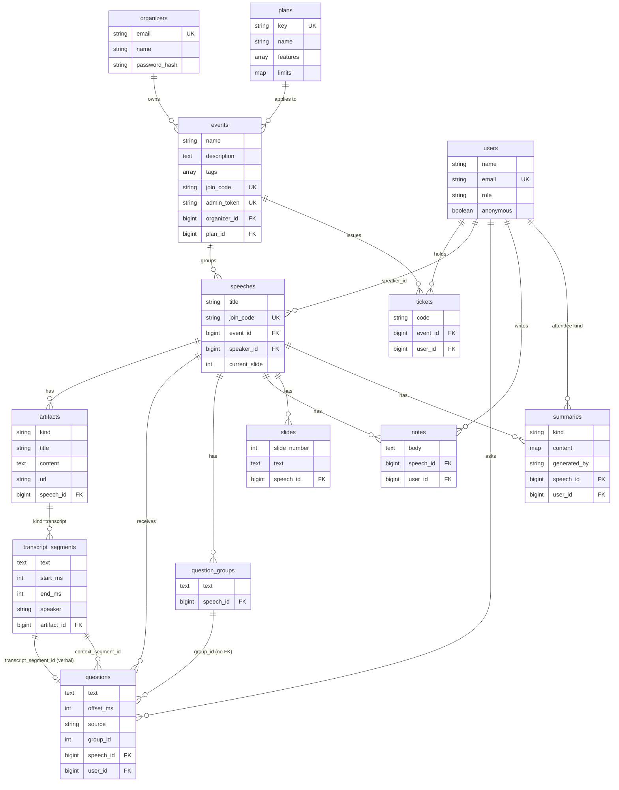

# Domain model

Every table lives in Postgres and is defined by an Ecto schema under `app/lib/takeaway/`. Elasticsearch holds derived copies only (see [questions.md](questions.md)); nothing here depends on it. For how the pieces run at runtime, see [architecture.md](architecture.md).

All tables have a `bigserial` `id` and `inserted_at` / `updated_at` (`:utc_datetime`) unless noted.

## Entity relationships

## Schemas

Column nullability and foreign-key `on_delete` come from the migrations; validations come from the changesets.

### `Takeaway.Accounts.User` (`users`)

`app/lib/takeaway/accounts/user.ex`. A speaker or an attendee; attendees may be anonymous.

| Field | Type | DB | Notes |
|---|---|---|---|
| `name` | string | null | Required when `role == "speaker"`. |
| `email` | string | null, unique index | `unique_constraint(:email)`. |
| `role` | string | not null, default `"attendee"` | One of `speaker`, `attendee`. |
| `anonymous` | boolean | not null, default false | Set by `Accounts.create_anonymous_attendee/0`. |

No associations declared on the schema. Referenced by `speeches.speaker_id`, `questions.user_id`, `notes.user_id`, `summaries.user_id`, `tickets.user_id`.

### `Takeaway.Organizers.Organizer` (`organizers`)

`app/lib/takeaway/organizers/organizer.ex`.

| Field | Type | DB | Notes |
|---|---|---|---|
| `email` | string | not null, unique | Trimmed and downcased; format check; max 160. |
| `name` | string | null | |
| `password` | string, virtual, redacted | | 8 to 72 characters. |
| `password_hash` | string, redacted | not null | `pbkdf2$<iterations>$<salt b64>$<hash b64>`, PBKDF2-HMAC-SHA256, 210,000 iterations by default (`:pbkdf2_iterations`). |

`has_many :events`. Only changeset: `registration_changeset/2`.

### `Takeaway.Events.Event` (`events`)

`app/lib/takeaway/events/event.ex`.

| Field | Type | DB | Notes |
|---|---|---|---|
| `name` | string | not null | Required. |
| `description` | string (`text` column) | null | |
| `tags` | `{:array, :string}` | not null, default `[]` | |
| `join_code` | string | not null, unique | Generated 6-character code (`Takeaway.JoinCode`) when absent. |
| `started_at`, `ended_at` | utc_datetime | null | |
| `admin_token` | string, redacted | not null, unique | Deprecated. See below. |
| `organizer_id` | `belongs_to :organizer` | FK `organizers`, `nilify_all` | Not cast; set by `Events.create_event/2` or `Organizers.claim_event/2`. |
| `plan_id` | `belongs_to :plan` | FK `plans`, `nilify_all` | Not cast; set only by `Billing.set_event_plan/2`. |

`has_many :speeches`.

Unused or deprecated fields:

- `admin_token`: legacy secret from before organizer accounts. `Event.changeset/2` still generates one on every insert (32 URL-safe characters) because the column is `NOT NULL` and unique, but nothing reads it (`app/lib/takeaway/events/event.ex`, `app/README.md`).
- `join_code`, `description`, `tags`, `started_at`, `ended_at`: stored but no route or LiveView in `app/lib/takeaway_web/` reads them. Attendees join speeches by the speech's own `join_code`. `Events.get_event_by_join_code/1` exists but has no caller in `app/lib`.

### `Takeaway.Billing.Plan` (`plans`)

`app/lib/takeaway/billing/plan.ex`.

| Field | Type | DB | Notes |
|---|---|---|---|
| `key` | string | not null, unique | e.g. `"free"`. |
| `name` | string | not null | |
| `features` | `{:array, :string}` | not null, default `[]` | Feature keys; `"*"` allows everything. Only `summaries` is checked in code. |
| `limits` | map | not null, default `%{}` | Free-form, e.g. `%{"max_speeches" => 5}`. Not read anywhere in `app/lib`. |

### `Takeaway.Tickets.Ticket` (`tickets`)

`app/lib/takeaway/tickets/ticket.ex`.

| Field | Type | DB | Notes |
|---|---|---|---|
| `code` | string | not null | Upcased; generated 8-character code when absent. Unique per event (`tickets_event_id_code_index` on `[event_id, code]`). |
| `event_id` | `belongs_to :event` | FK, not null, `delete_all` | Not cast; set on the struct. |
| `user_id` | `belongs_to :user` | FK, null, `nilify_all` | Not cast. `nil` for unowned generated tickets. |

### `Takeaway.Speeches.Speech` (`speeches`)

`app/lib/takeaway/speeches/speech.ex`.

| Field | Type | DB | Notes |
|---|---|---|---|
| `title` | string | not null | Required. |
| `description` | string (`text`) | null | |
| `tags` | `{:array, :string}` | not null, default `[]` | |
| `join_code` | string | not null, unique | Generated 6-character code; the attendee URL `/join/:code`. |
| `started_at`, `ended_at` | utc_datetime | null | Set by `Speeches.start_speech/2` / `end_speech/2`. |
| `current_slide` | integer | null | 1-based; set only via `SpeechCreator.set_current_slide/3`, not cast. |
| `event_id` | `belongs_to :event` | FK, not null, `delete_all` | Required. |
| `speaker_id` | `belongs_to :speaker` (User) | FK, null, `nilify_all` | Cast, but only `priv/repo/seeds.exs` sets it; `SpeechCreator.create_speech/3` does not. |

`has_many :notes`, `:questions`, `:artifacts`. Slides, question groups and summaries reference speeches but have no `has_many` on this schema.

### `Takeaway.Speeches.Artifact` (`artifacts`)

`app/lib/takeaway/speeches/artifact.ex`. A file or text attached to a speech.

| Field | Type | DB | Notes |
|---|---|---|---|
| `kind` | string | not null | One of `plan`, `slides`, `notes`, `transcript`. |
| `title` | string | null | Original upload name, or `"Live Transcript"`. |
| `content` | string (`text`) | null | Text of a `.txt` / `.md` plan; otherwise nil. |
| `url` | string | null | Stored file name inside `SpeechCreator.uploads_dir/0`, not a URL. |
| `speech_id` | `belongs_to :speech` | FK, not null, `delete_all` | |

`has_many :segments` (TranscriptSegment). Indexes on `[speech_id]` and `[speech_id, kind]`. The `transcript` artifact is created on first use by `Transcripts.get_or_create_artifact/1` and is the parent of all segments. No code creates `notes` artifacts.

### `Takeaway.Speeches.TranscriptSegment` (`transcript_segments`)

`app/lib/takeaway/speeches/transcript_segment.ex`.

| Field | Type | DB | Notes |
|---|---|---|---|
| `text` | string (`text`) | not null | |
| `start_ms`, `end_ms` | integer | not null | Milliseconds from speech start; `start_ms >= 0`, `end_ms >= start_ms`. |
| `speaker` | string | null | Diarization label (`"S1"` from the diarizer, or a provider label); nil when unknown. |
| `artifact_id` | `belongs_to :artifact` | FK, not null, `delete_all` | |

Index on `[artifact_id, start_ms]`.

### `Takeaway.Questions.Question` (`questions`)

`app/lib/takeaway/questions/question.ex`.

| Field | Type | DB | Notes |
|---|---|---|---|
| `text` | string (`text`) | not null | |
| `offset_ms` | integer | not null, default 0 | Time since speech start at submission (or the segment start for verbal questions); `>= 0`. |
| `slide_number` | integer | null | `> 0`. |
| `source` | string | not null, default `"typed"` | `typed` (attendee) or `verbal` (detected in transcript). |
| `user_id` | `belongs_to :user` | FK, null, `delete_all` | Required for `typed`; nil for `verbal`. |
| `speech_id` | `belongs_to :speech` | FK, not null, `delete_all` | |
| `transcript_segment_id` | `belongs_to :transcript_segment` | FK, null, `nilify_all`, unique | The segment a verbal question came from; uniqueness makes verbal creation idempotent. |
| `context_segment_id` | `belongs_to :context_segment` | FK, null, `nilify_all` | Transcript context attached by tagging. Not cast; written by `Questions.Tagging`. |
| `context_offset_ms` | integer | null | Start of the context segment. Not cast. |
| `context_source` | string | null | `"current"` or `"matched"`. Not cast. |
| `slide_source` | string | null | `"current"`, `"manual"` or `"matched"`. Not cast. |
| `tag` | string | null | Display label, e.g. `"Slide 3 · 04:12"`. Not cast. |
| `group_id` | integer | null | Points at `question_groups.id` but is a plain integer column without a foreign key. |
| `retracted_at` | utc_datetime | null | Set by retraction; retracted questions are excluded from lists and counts. |
| `answered_at` | utc_datetime | null | Set by `Questions.mark_answered_by_segments/2` (verbal questions only). |

Indexes: `[speech_id]`, `[user_id]`, `[speech_id, group_id]`, `[speech_id, context_segment_id]`, unique `[transcript_segment_id]`.

### `Takeaway.Questions.Group` (`question_groups`)

`app/lib/takeaway/questions/group.ex`. No changeset; rows are inserted and updated by `Questions.Grouping`.

| Field | Type | DB | Notes |
|---|---|---|---|
| `text` | string (`text`) | not null | Representative question text; replaced when the representative is retracted. |
| `count` | integer, virtual, default 0 | | Not populated anywhere; counts are derived from questions (`Questions.list_top_groups/2`). |
| `speech_id` | `belongs_to :speech` | FK, not null, `delete_all` | |

### `Takeaway.Notes.Note` (`notes`)

`app/lib/takeaway/notes/note.ex`.

| Field | Type | DB | Notes |
|---|---|---|---|
| `body` | string (`text`) | not null, default `""` | Max 20,000 characters; an emptied note is saved as `""`. |
| `user_id` | `belongs_to :user` | FK, not null, `delete_all` | |
| `speech_id` | `belongs_to :speech` | FK, not null, `delete_all` | |

Unique `[speech_id, user_id]` (one note per attendee and speech). Notes are not indexed in Elasticsearch: the `notes` index and `Elasticsearch.index_note/2` exist (`app/lib/takeaway/elasticsearch.ex`) but nothing calls them.

### `Takeaway.Slides.Slide` (`slides`)

`app/lib/takeaway/slides/slide.ex`.

| Field | Type | DB | Notes |
|---|---|---|---|
| `slide_number` | integer | not null | `> 0`; unique with `speech_id`. |
| `text` | string (`text`) | not null, default `""` | Extracted text, capped at 20,000 characters by `Slides.upsert_slides/2`. `""` for image-only slides. |
| `speech_id` | `belongs_to :speech` | FK, not null, `delete_all` | Not cast; set on the struct. |

### `Takeaway.Summaries.Summary` (`summaries`)

`app/lib/takeaway/summaries/summary.ex`.

| Field | Type | DB | Notes |
|---|---|---|---|
| `kind` | string | not null | `speaker` or `attendee`. |
| `content` | map (jsonb) | not null, default `%{}` | Speaker: `summary`, `question_groups`, `question_spikes`, `total_questions`, `has_transcript`. Attendee: `cliffnotes`, `notes`, `has_transcript`. |
| `generated_by` | string | null | `inspect` of the LLM module, `"extractive"` or `"none"`. |
| `speech_id` | `belongs_to :speech` | FK, not null, `delete_all` | |
| `user_id` | `belongs_to :user` | FK, null, `delete_all` | Set for attendee summaries. |

Partial unique indexes: `summaries_speaker_unique` on `[speech_id] WHERE kind = 'speaker'`, `summaries_attendee_unique` on `[speech_id, user_id] WHERE kind = 'attendee'`.

## Context APIs

Public functions only. File paths are under `app/lib/takeaway/`.

### Accounts (`accounts.ex`)

| Purpose | Functions |
|---|---|
| Create | `create_user/1`, `create_speaker/1` (forces `role: "speaker"`), `create_anonymous_attendee/0` |
| Read | `get_user/1`, `get_user!/1` |

### Organizers (`organizers.ex`)

| Purpose | Functions |
|---|---|
| Registration | `register/1`, `change_registration/2` |
| Lookup | `get_organizer/1`, `get_organizer_by_email/1` (normalizes email) |
| Login | `authenticate/2`: returns the organizer or `nil`; spends the same hashing time for unknown emails |
| Ownership | `claim_event/2`, `owns_event?/2`, `owns_speech?/2` |
| Hashing | `hash_password/1` |

### Events (`events.ex`)

| Purpose | Functions |
|---|---|
| Read | `list_events/0`, `get_event/1`, `get_event!/1`, `get_event_by_join_code/1` |
| Owner-scoped | `get_event_for_organizer/2` (nil for missing or foreign), `list_events_for_organizer/1` |
| Write | `create_event/2` (optional organizer owner), `update_event/2` |
| Paths | `tickets_path/1` |

### Billing (`billing.ex`)

| Purpose | Functions |
|---|---|
| Plans | `create_plan/1`, `get_plan_by_key/1`, `default_plan/0` (stored `"free"` plan, else a built-in allow-all plan) |
| Assignment | `set_event_plan/2` (the only writer of `events.plan_id`; no caller in `app/lib`) |
| Resolution | `plan_for_event/1`, `plan_for_speech/1` |
| Gating | `feature_allowed?/2`, `speech_feature_allowed?/2` |

### Tickets (`tickets.ex`)

| Purpose | Functions |
|---|---|
| Create | `create_ticket/4` (owner from structs only; generated code retried up to 5 times, each insert in a savepoint), `generate_tickets/2` (1 to 500, one transaction), `import_tickets/2` (`email` or `email,name` lines; returns `%{created, skipped, invalid}`) |
| Read | `get_ticket_by_code/2`, `list_tickets/1`, `event_uses_tickets?/1` |
| Join gate | `validate_for_event/2`: `:ok`, `{:error, :ticket_required}` or `{:error, :invalid_ticket}`; events without tickets always pass |

### Speeches (`speeches.ex`)

| Purpose | Functions |
|---|---|
| Speeches | `list_speeches/1`, `get_speech/1`, `get_speech!/1`, `get_speech_by_join_code/1`, `create_speech/1`, `update_speech/2` |
| Lifecycle (no broadcast) | `start_speech/2`, `end_speech/2` |
| Artifacts | `create_artifact/1`, `list_artifacts/2`, `get_artifact/1`, `get_artifact!/1` |
| Segments | `add_transcript_segment/1`, `list_transcript_segments/1` |

`Takeaway.SpeechCreator` (`speech_creator.ex`) wraps these for the web layer:

| Purpose | Functions |
|---|---|
| Creation | `create_speech/3` (speech plus uploaded files in one transaction, into the organizer's first event or a shared unowned "Open Talks" event; then `Slides.extract_async/1`), `parse_tags/1`, `uploads_dir/0` |
| Lifecycle (broadcasts) | `start_speech/1`, `end_speech/1` (idempotent) |
| Slides | `current_slide/2`, `set_current_slide/3`, `max_slide/0` (999) |
| PubSub | `topic/1`, `subscribe/1` |

### Transcripts (`transcripts.ex`)

| Purpose | Functions |
|---|---|
| Ingest | `ingest_chunk/4` (STT plus optional diarizer), `record_segments/3` (persist, broadcast, index, create verbal questions, mark answered) |
| Read | `get_or_create_artifact/1`, `list_segments/1`, `list_question_segments/1` |
| PubSub | `topic/1`, `subscribe/1` |

### Questions (`questions.ex`)

| Purpose | Functions |
|---|---|
| Attendee actions | `submit_question/4` (filter, insert, inline context tag, broadcast), `retract_question_by/2` (`{:error, :not_found}` / `{:error, :forbidden}`) |
| Verbal questions | `question?/1` (heuristic), `create_verbal_questions/1`, `mark_answered_by_segments/2` |
| Read | `list_questions/2` (`include_retracted:` option), `list_top_groups/2` (default limit 10), `get_question/1`, `get_question!/1` |
| Low-level writes | `create_question/1`, `retract_question/2`, `assign_group/2` (no caller in `app/lib`) |
| Filtering | `filter_text/1` (configurable hook, default `Questions.Filter.filter/1`) |
| PubSub | `topic/1`, `global_topic/0`, `subscribe/1`, `subscribe_global/0` |

Supporting modules: `Questions.Grouping` (`similarity/2`, `assign/1`, `assign_pending/1`, `retract/1`), `Questions.Tagging` (`attach_current/3`, `enrich/1`, `attach_delayed/2`, `label/2`), `Questions.Filter` (`check/1`, `filter/1`). See [questions.md](questions.md).

### Notes (`notes.ex`)

| Purpose | Functions |
|---|---|
| Read | `list_notes/2`, `get_note/1`, `get_note!/1`, `get_note_for/2` |
| Write | `save_note/3` (upsert on `[speech_id, user_id]`, last write wins; used by the attendee page), `create_note/1`, `update_note/2` |

### Slides (`slides.ex`)

| Purpose | Functions |
|---|---|
| Read | `list_slides/1`, `count_slides/1`, `get_slide/2`, `title/1` |
| Write | `upsert_slides/2` (replace 1..n, delete higher numbers) |
| Extraction | `extract_async/1`, `process_artifact/2` |
| Indexing | `index_slides/1` (returns `{indexed, failed}`) |

### Summaries (`summaries.ex`)

| Purpose | Functions |
|---|---|
| Cached reads | `get_speaker_summary/1`, `get_attendee_summary/2` |
| Generate or read | `speaker_summary/1`, `attendee_summary/2` (`{:error, :not_ended}`, `{:error, :plan_required}`) |
| On end | `generate_on_end/1` (speaker summary plus `{:summary_ready, id}` broadcast) |
| Gating | `allowed?/1` (plan feature `summaries`) |
| Analytics | `question_groups/1` (`@doc false`), `question_spikes/3` |
| PubSub | `topic/1`, `subscribe/1` |

## Migrations

All in `app/priv/repo/migrations/`.

| Version | File | Change |
|---|---|---|
| 20261109190000 | `create_domain_tables.exs` | Creates `users`, `events`, `speeches`, `questions`, `notes`, `artifacts`, `transcript_segments` with their indexes. |
| 20261109210000 | `create_summaries.exs` | Creates `summaries` with partial unique indexes for speaker and attendee kinds. |
| 20261109210811 | `create_slides.exs` | Creates `slides`, unique `[speech_id, slide_number]`. |
| 20261109212227 | `create_question_groups.exs` | Creates `question_groups`, index on `speech_id`. |
| 20261109220000 | `create_tickets.exs` | Creates `tickets`, unique `[event_id, code]`. |
| 20261109220431 | `create_plans.exs` | Creates `plans`, unique `key`. |
| 20261109223156 | `add_question_context_tags.exs` | Adds `context_segment_id`, `context_offset_ms`, `tag`, `context_source`, `slide_source` to `questions`. |
| 20261109230000 | `add_speaker_to_transcript_segments.exs` | Adds `transcript_segments.speaker`. |
| 20261109230100 | `add_plan_to_events.exs` | Adds `events.plan_id` (FK `plans`, `nilify_all`). |
| 20261109230200 | `add_source_to_questions.exs` | Adds `questions.source` and `transcript_segment_id` (unique); makes `questions.user_id` nullable. |
| 20261109230300 | `add_admin_token_to_events.exs` | Adds `events.admin_token`, backfills random tokens, sets `NOT NULL` and unique (now deprecated). |
| 20261109230400 | `add_answered_at_to_questions.exs` | Adds `questions.answered_at`. |
| 20261109230500 | `create_organizers.exs` | Creates `organizers`; adds `events.organizer_id`. |
| 20261110090000 | `unique_note_per_attendee_and_speech.exs` | Deletes duplicate notes (keeps highest id), adds unique `[speech_id, user_id]`. |
| 20261110100000 | `add_current_slide_to_speeches.exs` | Adds nullable `speeches.current_slide`. |
