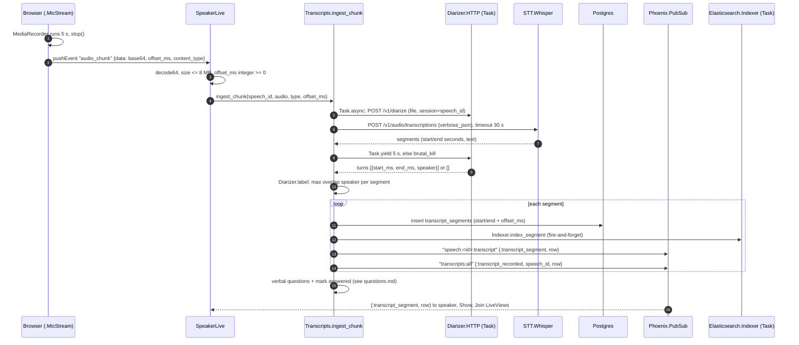

# Live speech pipeline

How audio from the speaker's microphone becomes transcript segments on attendees' screens, how uploaded slide decks become searchable per-slide text, and how post-speech summaries are produced.

Related: [architecture.md](architecture.md) (supervision tree, contexts), [domain-model.md](domain-model.md) (tables), [web.md](web.md) (LiveViews and routes), [configuration.md](configuration.md) (environment variables), [deployment.md](deployment.md) (Whisper, diarizer and Elasticsearch manifests), [observability.md](observability.md) (spans), [questions.md](questions.md) (questions and Elasticsearch).

## Overview

| Stage | Code | Runs where |
|---|---|---|
| Mic capture, 5 s chunks | `.MicStream` colocated hook in `app/lib/takeaway_web/live/speaker_live.ex` | Speaker's browser |
| Chunk intake | `TakeawayWeb.SpeakerLive.handle_event("audio_chunk", ...)` | Speaker's LiveView process |
| Speech-to-text | `Takeaway.STT`, `Takeaway.STT.Whisper` (`app/lib/takeaway/stt.ex`, `stt/whisper.ex`) | HTTP to Service `whisper` |
| Speaker labels | `Takeaway.Diarizer`, `Takeaway.Diarizer.HTTP` (`app/lib/takeaway/diarizer.ex`), `diarizer/server.py` | HTTP to Service `diarizer` |
| Persist, broadcast, index | `Takeaway.Transcripts` (`app/lib/takeaway/transcripts.ex`) | Speaker's LiveView process |
| Display | `TakeawayWeb.SpeakerLive`, `SpeechLive.Show`, `SpeechLive.Join` | Subscribed LiveViews |

The mic hook is not in `app/assets/js/app.js`. That file only registers the `TabList` hook and merges in the colocated hooks (`phoenix-colocated/takeaway`). `.MicStream` and `.SlideKeys` are defined in the `<script :type={Phoenix.LiveView.ColocatedHook}>` blocks at the bottom of `speaker_live.ex`.

## One audio chunk

Everything after the `audio_chunk` event, except the diarizer and indexer tasks, runs synchronously inside the speaker's LiveView process, so the LiveView handles one chunk at a time; a slow STT call delays the next chunk's processing (chunks queue in the process mailbox).

## 1. Capture in the browser

Source: `.MicStream` hook, `app/lib/takeaway_web/live/speaker_live.ex`.

| Item | Value |
|---|---|
| Chunk length | `CHUNK_MS: 5000` |
| Recording API | `navigator.mediaDevices.getUserMedia({audio: true})` + `MediaRecorder` with the browser's default MIME type |
| Format | Whatever `rec.mimeType` the browser picks (typically `audio/webm;codecs=opus` in Chromium/Firefox, may be `audio/ogg` or `audio/mp4` elsewhere); sent as `content_type` |
| Chunking | A new `MediaRecorder` per chunk (`cycle()`), so each chunk is a standalone, decodable file with container headers. Timeslice chunks are deliberately not used. |
| Encoding on the wire | Base64 of the whole blob, built in 32 KiB slices (`0x8000`) to avoid argument-length limits on `String.fromCharCode.apply` |
| `offset_ms` | `Date.now() - startedAt` at the start of that chunk, where `startedAt` is when the mic was turned on (not the speech's `started_at`) |
| Event | `pushEvent("audio_chunk", {data, offset_ms, content_type})` |
| Recording state | `pushEvent("recording", {on: true/false})` toggles the button and "Live" badge |

Notes:

- If `getUserMedia` is refused the hook returns silently; no event is pushed.
- Empty chunks (`parts.length === 0`) are not sent.
- Stopping and restarting the mic resets `startedAt`, so offsets restart at 0 for the new recording session. Segment timestamps are therefore relative to mic start, not to the speech start.
- Because each chunk is recorded independently, a word straddling a 5 s boundary can be split or dropped. There is no overlap between chunks.

## 2. Chunk intake (`SpeakerLive`)

`handle_event("audio_chunk", ...)` in `speaker_live.ex`:

- `content_type` defaults to `"audio/webm"` when absent.
- Rejects (flash "Could not transcribe an audio chunk") when base64 is invalid, the decoded chunk exceeds `@max_chunk_bytes` (8,000,000), `offset_ms` is not a non-negative integer, or `Transcripts.ingest_chunk/4` returns an error.
- Only the owning organizer can mount this page (`owned_speech/2` uses `Organizers.owns_speech?/2`). Audio is accepted whether or not the speech has been started; the speech's `started_at`/`ended_at` gate slide controls, not transcription.

## 3. Speech-to-text (`Takeaway.STT`)

`Takeaway.STT` (`app/lib/takeaway/stt.ex`) is a behaviour with one callback, `transcribe(audio, content_type, opts) :: {:ok, [segment]} | {:error, term}`. Segment offsets are milliseconds relative to the chunk. The implementation is `config :takeaway, :stt`; the default `Takeaway.STT.Disabled` logs at debug level and returns `{:ok, []}` (no transcript, no error).

`config/runtime.exs` switches to `Takeaway.STT.Whisper` when `STT_URL` is set.

### `Takeaway.STT.Whisper` (`app/lib/takeaway/stt/whisper.ex`)

OpenAI-compatible `/audio/transcriptions` client using Erlang `:httpc`.

| Aspect | Value |
|---|---|
| Method / body | `POST`, hand-built `multipart/form-data` with a random boundary |
| Form fields | `model`, `response_format=verbose_json`, optional `diarize=true`, `file` (filename `chunk.ogg` if the content type contains `ogg`, otherwise `chunk.webm`; part `Content-Type` is the browser's type) |
| Auth | `Authorization: Bearer <STT_API_KEY>` only when an API key is configured |
| Timeout | `:httpc` `timeout: 30_000` (30 s) |
| Retries | None |
| Model | `STT_MODEL`, default `"whisper-1"`; the cluster sets `Systran/faster-whisper-small` (`deploy/deployment.yaml`) |
| Diarize | `STT_DIARIZE` in `true/1/yes/on` sets `diarize: true`; off by default |

Response parsing (`parse/1`):

- `{"segments": [...]}`: each segment with non-blank `text` becomes `%{text, start_ms, end_ms}` (seconds x 1000, rounded); a non-empty `speaker` string is passed through as `:speaker`.
- `{"text": ...}` without segments: one segment from 0 to `duration` (or 0), unless the text is blank (then `[]`).
- Anything else: `{:error, :bad_response}`. Non-200 status: `{:error, {:http, status, body}}`.

In the cluster the endpoint is Speaches (faster-whisper, CPU) from `deploy/whisper.yaml`: one replica, `int8`, 2 threads, model preloaded and kept resident (`STT_MODEL_TTL=-1`).

## 4. Speaker diarization

### Elixir side (`app/lib/takeaway/diarizer.ex`)

- `Takeaway.Diarizer` behaviour: `diarize(audio, content_type, session) :: {:ok, [turn]} | {:error, term}`, where a turn is `%{start_ms, end_ms, speaker}` relative to the chunk. `session` is the speech id as a string.
- Implementation from `config :takeaway, :diarizer`. Default `Takeaway.Diarizer.Disabled` returns `{:ok, []}`; `enabled?/0` is false for it, and then no task is started at all. `runtime.exs` selects `Takeaway.Diarizer.HTTP` when `DIARIZER_URL` is set.
- `Takeaway.Diarizer.HTTP` posts with `Req`: `form_multipart` fields `session` and `file` (same filename rule as STT), `receive_timeout` from config `:timeout` (default 15,000 ms), `retry: false`. It keeps only segments with numeric `start`/`end` and a non-empty `speaker`.
- `label(segments, turns)`: for each STT segment without a `:speaker`, sums the overlap in ms with each speaker's turns and picks the speaker with the largest total. Segments that already have a provider label keep it; segments no turn overlaps stay unlabelled.

### How `Transcripts.ingest_chunk/4` combines them

Source: `app/lib/takeaway/transcripts.ex`.

1. If the diarizer is enabled, start `Task.async(fn -> safe_diarize(...) end)`. `safe_diarize` rescues and catches everything, because the task is linked to the speaker's LiveView.
2. Call STT synchronously.
3. On STT success, `Task.yield(task, 5_000) || Task.shutdown(task, :brutal_kill)`: the diarizer gets STT's duration plus 5 s. Any non-`{:ok, turns}` result logs a warning and yields `[]`.
4. On STT error, the diarizer task is killed and the error is returned (the chunk produces no segments).

A diarizer failure only costs labels for that chunk, never the transcript.

### Python service (`diarizer/server.py`)

FastAPI app, one uvicorn worker on port 8000 (`diarizer/Dockerfile`).

| Endpoint | Behaviour |
|---|---|
| `GET /health` | `{"status": "ok"}` once models are loaded, `"loading"` before |
| `POST /v1/diarize` | multipart `file` (required) and `session` (form, default `"default"`, truncated to 128 chars). Returns `{"duration": s, "segments": [{"start", "end", "speaker"}]}` with times rounded to 3 decimals |

Errors: body over `MAX_UPLOAD_BYTES` (8,000,000) is 413; ffmpeg decode failure or a 30 s ffmpeg timeout is 400. Audio shorter than 0.3 s returns empty `segments`.

Processing:

1. `decode()` writes the upload to a temp file and runs `ffmpeg` to 16 kHz mono `f32le` (any container ffmpeg reads).
2. sherpa-onnx `OfflineSpeakerDiarization` (pyannote segmentation 3.0 + WeSpeaker ResNet34 English embeddings, CPU) finds local speakers in the chunk. Clustering uses `FastClusteringConfig(num_clusters=-1, threshold=CLUSTER_THRESHOLD)`, `min_duration_on=0.3`, `min_duration_off=0.5`.
3. For each local speaker (ordered by first speech), the audio of all its spans is concatenated and a unit-length embedding computed; if under `MIN_EMBED_SECONDS` of audio, the embedding is `None`.
4. `Sessions.match()` maps each local speaker to a stable name `S1`, `S2`, ... for the session.

All sherpa-onnx calls are serialized by a global `threading.Lock`.

Models are downloaded at image build time into `/models` (`segmentation.onnx`, `embedding.onnx`); no Hugging Face token or PVC is needed.

#### Voiceprint matching

State per session (`Sessions`, in memory): `prints` (name -> sum of unit embeddings, count), `next` (next number), `last` (most recent name), `seen` (monotonic time).

| Case | Result |
|---|---|
| Embedding is `None` (too little speech) | Reuse `last`; if there is none, allocate a new name without a voiceprint |
| Best cosine similarity to a stored print (normalized sum) `>= MATCH_THRESHOLD` | That name; the embedding is added to its sum |
| Otherwise | New name `S<next>` with this embedding as its print |

#### Environment

| Variable | Default | Meaning |
|---|---|---|
| `MODEL_DIR` | `/models` | Model location |
| `NUM_THREADS` | `1` | ONNX threads |
| `CLUSTER_THRESHOLD` | `0.3` | Cosine distance for merging local clusters within a chunk (bigger = fewer speakers) |
| `MATCH_THRESHOLD` | `0.7` | Cosine similarity needed to match a known voiceprint. Raise if two people share a label; lower if one person gets several |
| `MIN_EMBED_SECONDS` | `0.8` | Minimum speech per local speaker to compute a voiceprint |
| `MAX_SESSIONS` | `200` | LRU cap on sessions (oldest evicted) |
| `SESSION_TTL_SECONDS` | `21600` (6 h) | Idle sessions expire |

Because voiceprints live in process memory, `deploy/diarizer.yaml` runs exactly one replica with `strategy: Recreate`. A restart (or eviction past `MAX_SESSIONS` / TTL) restarts numbering at `S1` for speeches in progress.

#### Label display

`SpeakerLive.speaker_name/1` shows both `S1` (this diarizer, 1-based) and `SPEAKER_00` (provider labels, 0-based) as "Speaker 1". `mark_turns/2` sets `:new_speaker` on a segment whose speaker differs from the previous labelled one; the transcript list shows a badge only there.

## 5. Persisting and broadcasting (`Takeaway.Transcripts`)

`record_segments(speech_id, segments, offset_ms)`:

1. `get_or_create_artifact/1` finds or creates the speech's `kind: "transcript"` artifact titled "Live Transcript".
2. Each segment is inserted via `Speeches.add_transcript_segment/1` with `start_ms`/`end_ms` shifted by the chunk's `offset_ms`. Rows that fail validation are silently skipped (the `for ... {:ok, row} <- [...]` filter).
3. For each saved row:
   - `Takeaway.Indexer.index_segment/1` (Elasticsearch, asynchronous; see [questions.md](questions.md#elasticsearch)).
   - Broadcast `{:transcript_segment, row}` on `"speech:<id>:transcript"` (`Transcripts.topic/1`).
   - Broadcast `{:transcript_recorded, speech_id, row}` on `"transcripts:all"` (consumed by `Questions.TagWorker`).
4. If any saved segment passes `Questions.question?/1`, `Questions.create_verbal_questions/1` runs; if anything was saved, `Questions.mark_answered_by_segments/1` runs. See [questions.md](questions.md#verbal-questions-from-the-transcript).

### `TranscriptSegment` (`app/lib/takeaway/speeches/transcript_segment.ex`)

| Field | Notes |
|---|---|
| `text` | required |
| `start_ms`, `end_ms` | required; `start_ms >= 0`, `end_ms >= start_ms` |
| `speaker` | optional label (`S1` from the diarizer, or a provider label) |
| `artifact_id` | required, the transcript artifact |

Segments are listed by `Speeches.list_transcript_segments/1` ordered by `start_ms, id`.

### Who receives segments

| LiveView | Subscribes | Shows |
|---|---|---|
| `SpeakerLive` (`/speeches/:id/speak`) | `Transcripts.subscribe/1` on connected mount | All segments, live |
| `SpeechLive.Show` (`/speeches/:code`) | same | Segments once the speech has started (`initial_segments/1`) |
| `SpeechLive.Join` (`/join/:code`) | same | Live captions; initial list loaded only while the speech is live (`load_captions/2`), reloaded on `{:speech_started, ...}` |

Each uses `SpeakerLive.insert_segment/2` to stream-insert and mark speaker turns.

PubSub is `Phoenix.PubSub` named `Takeaway.PubSub` (`app/lib/takeaway/application.ex`). Broadcasts reach other app pods only if the nodes are clustered via `DNSCluster` (`DNS_CLUSTER_QUERY`, read in `config/runtime.exs`). `deploy/deployment.yaml` runs `replicas: 2` and does not set `DNS_CLUSTER_QUERY`, so as checked in, an attendee connected to a different pod than the speaker does not receive live segments until the page re-mounts (mount re-reads the transcript from Postgres). See [deployment.md](deployment.md).

## Slides

Source: `app/lib/takeaway/slides.ex`, `slides/extractor.ex`, `slides/pdf.ex`, `slides/pptx.ex`, `slides/slide.ex`, `app/lib/takeaway/speech_creator.ex`.

### Upload and trigger

- `SpeechLive.New` (`app/lib/takeaway_web/live/speech_live/new.ex`) accepts one slides file (`.pdf .ppt .pptx`, max 50,000,000 bytes) and one plan (`.txt .md .pdf .doc .docx`, max 10,000,000 bytes).
- `SpeechCreator.create_speech/3` inserts the speech and artifacts in one transaction. Each file is copied to `uploads_dir()` as `<speech_id>-<kind>-<unique>.<ext>`; the artifact's `url` is that stored file name. `uploads_dir` is `config :takeaway, :uploads_dir` or `<System.tmp_dir!>/takeaway_uploads` (no volume is mounted in `deploy/deployment.yaml`, so this is pod-local).
- After commit, every `slides` artifact goes to `Slides.extract_async/1`, which starts a task under `Takeaway.Slides.TaskSupervisor` and returns immediately. Speech creation never waits for, or fails because of, extraction.
- `config :takeaway, :extract_slides, false` disables it (`config/test.exs`).

### Locking

Inside the task, `:global.trans({Takeaway.Slides, self()}, fun, [node()])` takes a lock on the resource `Takeaway.Slides`, scoped to the local node. Extractions on one pod run one at a time; others wait. Pods do not coordinate (each extracts only the uploads it received). The OpenTelemetry context of the caller is attached to the task so the span links to the request.

### Extraction

`Slides.Extractor.extract/2` dispatches to `config :takeaway, :slide_extractor` (default `Takeaway.Slides.Extractor.Default`), which picks by extension:

| Extension | Extractor | Method |
|---|---|---|
| `.pdf` | `Takeaway.Slides.Pdf` | One `pdftotext -enc UTF-8 -q -l <max_pages> <abs path> -` run; pages split on form feed |
| `.pptx` | `Takeaway.Slides.Pptx` | Pure Elixir: zip directory via `:zip.list_dir`, slide order from `ppt/presentation.xml` + its rels (fallback: `slideN.xml` numbering), text from `<a:t>` runs, one line per `<a:p>` |
| anything else (incl. `.ppt`) | none | `{:error, :unsupported_format}` |

`Extractor.clean_text/1` normalizes: invalid UTF-8 replaced, runs of spaces/tabs/NBSP collapsed, lines trimmed, blank lines dropped. Image-only slides yield `""`.

### Limits

| Limit | Value | Where |
|---|---|---|
| Upload size | 50 MB | `speech_live/new.ex` |
| Max slides read | 300 (`:max_pages`) | `extractor.ex`, `pdf.ex`, `pptx.ex` |
| `pdftotext` wall time | 120 s, enforced with coreutils `timeout -s KILL` (skipped where `timeout` is unavailable or on Windows) | `pdf.ex` |
| PPTX uncompressed size per XML part | 5,000,000 bytes, enforced during inflate (`:zlib.safeInflate` loop) | `pptx.ex` |
| Text stored per slide | 20,000 chars | `slides.ex` `@max_text` |
| Text sent to the index per slide | 8,000 chars | `@max_index_text` |
| Title (first non-blank line) | 200 chars | `@max_title` |

PPTX XML is scanned with regular expressions, not an XML parser, so entity expansion does not apply; only the five XML entities and numeric references are unescaped.

### Storage and indexing

- `Slides.upsert_slides/2` inserts rows `1..n` in chunks of 1,000 with `on_conflict: {:replace, [:text, :updated_at]}` on `(speech_id, slide_number)` (unique index in `priv/repo/migrations/20261109210811_create_slides.exs`), deletes rows numbered above `n`, all in one transaction.
- `Slides.index_slides/1` calls `Takeaway.Indexer.index_slide/1` for each slide with `%{speech_id (string), slide_number, title, content}`. Failures are counted and logged; stored rows are kept.

### Failure handling

`process_artifact/2` wraps everything in a `slides.extract` span and rescues/catches all errors; it never raises.

| Outcome | Logging | Span |
|---|---|---|
| `{:ok, slides}` | info: number of slides | attributes `slides.count`, `slides.indexed`, `slides.index_failed`, `slides.empty` |
| `:unsupported_format` | info: skipped | `slides.skipped = unsupported_format` |
| any other error (`:enoent`, `:pdftotext_not_found`, `:unreadable_pdf`, `:timeout`, `{:pdftotext_exit, code}`, `:not_a_pptx`, exceptions) | warning with speech and artifact id | status error |

PPTX parts that fail to read (too large, bad deflate, unsupported compression) become `""` for that slide rather than failing the deck. A pod restart mid-extraction loses the job; there is no retry.

### Current slide

`SpeechCreator.set_current_slide/3` clamps to `1..count` (or `1..999` with no extracted deck), saves `speeches.current_slide` and broadcasts `{:slide_changed, speech_id, n}` on `"speech:<id>"`; a no-op move does not broadcast. `SpeakerLive` only allows changes while the speech is live and owned by the current organizer, and recounts slides when its cached count is 0 (extraction may finish after mount). Questions use this slide for tags ([questions.md](questions.md#context-tags)).

## Summaries

Source: `app/lib/takeaway/summaries.ex`, `summaries/summary.ex`, `app/lib/takeaway/llm.ex`, `llm/anthropic.ex`.

### When they are generated

Generation is driven by LiveViews, not by `end_speech` itself:

| Summary | Trigger | Code |
|---|---|---|
| Speaker | `SpeechLive.Show` (connected) mounts on an ended speech, or receives `{:speech_ended, speech}`, and no row is cached: `start_async(:summary, fn -> Summaries.generate_on_end(speech) end)` | `speech_live/show.ex` `load_allowed_summary/2` |
| Attendee | `SpeechLive.Join` (connected, with a session `user_id`) mounts on an ended speech or receives `{:speech_ended, ...}`, and no row is cached: `Summaries.attendee_summary(speech, uid)` | `speech_live/join.ex` `load_allowed_summary/3` |

So if no speaker control page is open when the speech ends, the speaker summary is generated the next time one is opened. `generate_on_end/1` broadcasts `{:summary_ready, speech_id}` on `"speech:<id>:summary"`, but nothing subscribes to that topic.

Preconditions (`speaker_summary/1`, `attendee_summary/2`):

- `ended_at` nil: `{:error, :not_ended}`.
- `Billing.speech_feature_allowed?(speech, :summaries)` false: `{:error, :plan_required}`; the LiveViews show a locked state.

### Caching

Table `summaries` (`Takeaway.Summaries.Summary`): `kind` (`speaker` | `attendee`), `content` (map), `generated_by`, `speech_id`, `user_id`. Partial unique indexes `summaries_speaker_unique` (`speech_id`) and `summaries_attendee_unique` (`speech_id, user_id`) (`priv/repo/migrations/20261109210000_create_summaries.exs`).

`store/3` inserts with `on_conflict: :nothing` and then re-reads, so concurrent generators converge on the first row. Once stored, a summary is never regenerated; there is no invalidation.

### Inputs

| Input | Speaker | Attendee |
|---|---|---|
| Transcript | All segments joined by spaces, trimmed, first 12,000 chars (`@max_transcript_chars`) | same |
| Speech title | yes | yes |
| Description | yes (`(none)` if nil) | no |
| Questions | All non-retracted, one `- text` line each | no |
| Attendee notes | no | That user's non-blank note bodies, separated by `---` |

Before building the speaker summary, if `:question_grouping` is enabled (default true), `Questions.Grouping.assign_pending/1` groups any still-ungrouped questions synchronously.

System prompts (verbatim in `summaries.ex`): speaker, 3-5 sentences, plain text, main points and what the audience asked; attendee, a bullet list (`- ` per line) merging the talk with the attendee's notes marked "You noted:". Both say not to invent content.

### Content

| Kind | Keys |
|---|---|
| speaker | `summary`, `question_groups` (top 5 by count: `label`, `count`, `questions`), `question_spikes`, `total_questions`, `has_transcript` |
| attendee | `cliffnotes`, `notes`, `has_transcript` |

`question_groups/1` groups by `group_id` (ungrouped questions are singletons). `question_spikes/3` splits the talk into 10 equal buckets over `max(last question offset + 1, last segment end, ended_at - started_at)`, keeps buckets with at least 2 questions, takes the 3 busiest and returns them in time order. Neither depends on the LLM.

### LLM and fallback

`Takeaway.LLM` is a behaviour (`complete(system, prompt, opts)`); implementation from `config :takeaway, :llm`, default `Takeaway.LLM.Disabled` (`{:error, :disabled}`). `runtime.exs` selects `Takeaway.LLM.Anthropic` when `ANTHROPIC_API_KEY` is set.

`Takeaway.LLM.Anthropic`:

| Aspect | Value |
|---|---|
| Endpoint | `POST https://api.anthropic.com/v1/messages` via `:httpc` |
| Headers | `x-api-key`, `anthropic-version: 2023-06-01` |
| Model | `ANTHROPIC_MODEL`, default `claude-sonnet-4-5` |
| `max_tokens` | 1024 (overridable via opts) |
| Timeout | 60 s; TLS verified against `:public_key.cacerts_get()` |
| Retries | None |
| Parsing | Concatenates all `text` blocks; blank result is `{:error, :empty}` |

`generated_by` records the source:

| Case | Text | `generated_by` |
|---|---|---|
| No transcript and no questions (speaker) / no transcript and no notes (attendee) | Fixed "nothing to summarize" sentence; LLM not called | `"none"` |
| LLM returns `{:ok, text}` | LLM text | `inspect(impl)`, e.g. `"Takeaway.LLM.Anthropic"` |
| LLM disabled or any error | Extractive fallback | `"extractive"` |

Extractive fallback: speaker gets `"Talk excerpt: <first 600 chars>..."` (or "No transcript was recorded...") plus `"N question(s) were asked."`; attendee gets the excerpt only (their notes are still in `content["notes"]`). A fallback summary is cached like any other, so a transient LLM failure is permanent for that speech.
